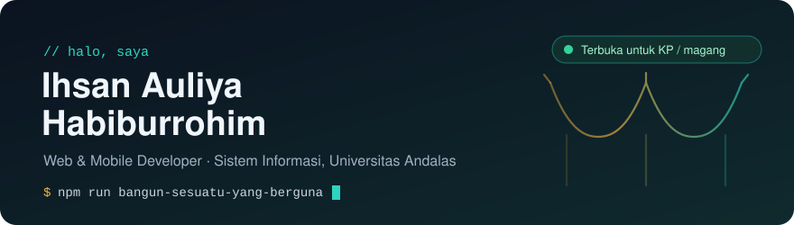
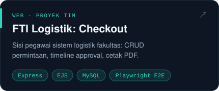
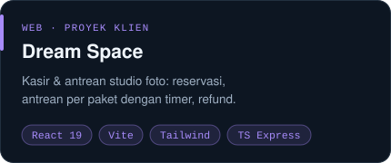
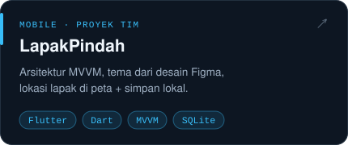
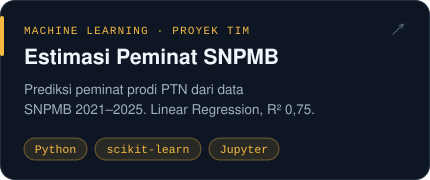
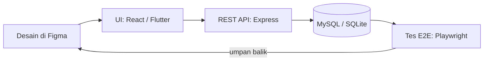

<p align="center">
  
</p>

<p align="center">
  <a href="https://www.linkedin.com/in/ihsan-auliya-habiburrohim"></a>
  <a href="mailto:ihsan.habiburrohim@gmail.com"></a>
  <a href="https://github.com/Biburs?tab=repositories"></a>
</p>

### Sedikit tentang saya

Saya mahasiswa Sistem Informasi di Universitas Andalas yang senang membangun aplikasi dari ujung ke ujung: mulai dari desain di Figma, tampilan web atau mobile, REST API, database, sampai tes end-to-end yang memastikan semuanya benar-benar jalan.

```ts
const ihsan = {
  fokus:     ["web full-stack", "mobile"],
  sukaBikin: ["REST API", "fitur CRUD", "dokumen PDF otomatis", "tes E2E"],
  sedang:    "mencari tempat kerja praktik / magang sebagai developer",
  belajar:   ["TypeScript lebih dalam", "Bahasa Inggris"],
};
```

### Proyek pilihan

<table>
  <tr>
    <td><a href="https://github.com/Biburs/B10-Transaksi-Checkout"></a></td>
    <td><a href="https://github.com/duhaalul/Dream-Space"></a></td>
  </tr>
  <tr>
    <td><a href="https://github.com/Shevaramadhan/mobile-lapakpindah"></a></td>
    <td><a href="https://github.com/samythh/estimasi-peminat-snpmb"></a></td>
  </tr>
</table>

### Alat yang saya pakai

<table>
  <tr>
    <td><b>Frontend</b></td>
    <td></td>
  </tr>
  <tr>
    <td><b>Backend &amp; data</b></td>
    <td></td>
  </tr>
  <tr>
    <td><b>Mobile</b></td>
    <td></td>
  </tr>
  <tr>
    <td><b>Data &amp; ML</b></td>
    <td></td>
  </tr>
  <tr>
    <td><b>Tes, desain &amp; kolaborasi</b></td>
    <td>
      
      
    </td>
  </tr>
</table>

### Cara saya bekerja



<p align="center">
  
</p>
